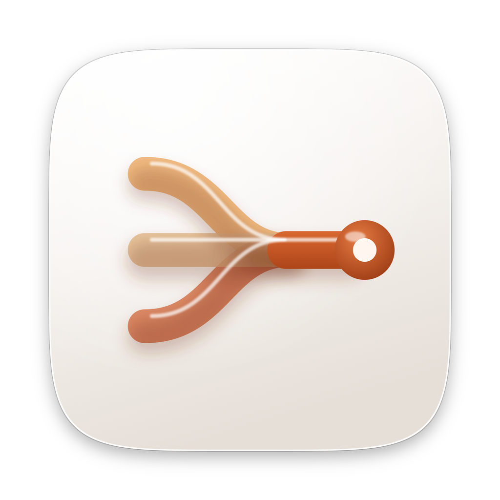
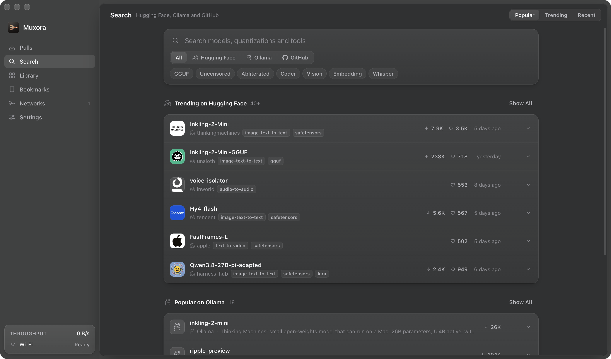

<p align="center"></p>

<h1 align="center">Muxora</h1>

<p align="center"><b>Many sources, one powerful stream.</b></p>

A native download manager that pulls AI models and big files over every network and mirror at
once, straight into Kalon, Ollama, the cloud, or any drive. Wi-Fi plus a phone tethered over USB
means two connections fetching the same file, each taking the share it's fastest at.



## Download

Get Muxora from [kalonedge.com](https://kalonedge.com) or from this repository's
[Releases](https://github.com/KalonEdge/Muxora/releases/latest): open `Muxora.dmg` and drag
Muxora into Applications.

Muxora is signed and notarized by Apple, and runs on macOS 14 or later on Apple silicon.
Windows and Linux versions are on the way.

## What it does

- **Every network at once.** Wi-Fi, Ethernet, a phone tethered over USB or Bluetooth: each
  network runs its own streams, and the fastest takes the most. Set a data limit per network to
  keep a phone plan safe, or turn any network off.
- **Every mirror at once.** A file published on many servers (a metalink, or a server that lists
  its mirrors) comes from all of them together.
- **Straight into Kalon.** Pick Kalon Models as the destination, or pull a model from Kalon's
  catalogue by name, and it's ready in Kalon's model picker under Kalon's own name.
- **Straight into Ollama.** Ollama models land in Ollama's store, ready for `ollama run`.
- **Straight to the cloud.** Google Drive and S3-compatible storage (Amazon S3, Cloudflare R2,
  Backblaze B2 and more): each piece goes up as it arrives, and nothing is saved on the Mac.
- **Any drive.** Your Downloads folder, an external disk, or any folder you choose.
- **Find models.** Search Hugging Face, Ollama and GitHub in one place, see which quantization
  fits and runs well on this Mac (and how fast), and compare them side by side.
- **Macs nearby.** Pair your Macs, and a model one of them already has comes over the local
  network instead of the internet.
- **Later.** Mark pulls for an overnight download window, and keep the Mac awake while they run.
- **Checked.** Every file with a published SHA-256 is checked before it's kept, whichever
  network, mirror or Mac sent it.

## What you can pull

| Paste | What happens |
| --- | --- |
| `llama3.2`, `qwen3:8b` | An Ollama model |
| `org/repo` | A Hugging Face repository |
| `org/repo:Q4_K_M` | Only that quantization of a Hugging Face model |
| `kalon:gemma4:2b` | A model from Kalon's catalogue, into Kalon |
| `https://…/file.iso` | Any download link, split across every network |
| a `.meta4` link, or several links | One file from every mirror at once |

## From the terminal

Settings › Command-line Tool installs `muxora`. Pulls started there show up in the app, and the
other way round.

```bash
muxora pull llama3.2                      # into Ollama
muxora pull kalon:gemma4:2b               # into Kalon
muxora pull org/repo:Q4_K_M --to drive    # straight to Google Drive
muxora ls                                 # what's pulling
muxora help                               # everything else
```

## Updates

Muxora updates itself from this repository's releases. It only ever installs a release signed
with Muxora's Developer ID whose download matches its published SHA-256. You can turn automatic
updates off in Settings, or choose Muxora › Check for Updates… at any time.

## Privacy

Muxora has no account and sends nothing about you anywhere. It talks only to the places you pull
from, to the cloud storage you connect, and to this repository to check for updates. Tokens and
cloud keys stay on your Mac, readable only by your account, and are never sent to any other
service. Downloaded files are marked as from the internet, so macOS checks any app or installer
among them the first time it opens.

## Security

See [SECURITY.md](SECURITY.md) to report an issue privately.

## License

MIT. See [LICENSE](LICENSE).
